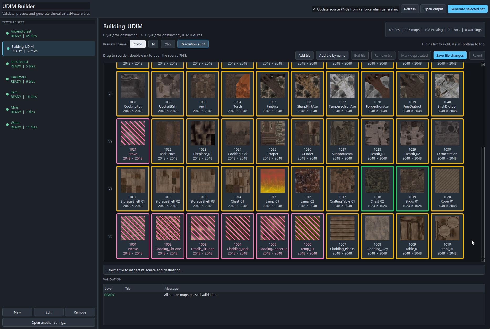

# UDIM Builder - Python / PySide6
### UE 5

A standalone tool that turns a folder of per-asset textures into UDIM tile sets for Unreal, with an Unreal-side menu to import the result.

It validates the source PNGs, previews the tile layout before anything is generated, writes the Unreal-facing PNGs, and leaves a manifest the editor importer reads. Perforce support is built in: it syncs sources before a build and checks out the files it needs to change.



## Requirements
- Python 3 on `PATH`, with PySide6 for the UI and P4Python for the Perforce integration.
- `UdimCombiner.bat` installs both if they are missing, or install them yourself with `python -m pip install -r UdimCombiner/requirements.txt`.

## Install
- **The builder:** copy `UdimCombiner` anywhere on disk. It runs on its own and does not need Unreal.
- **The Unreal menu:** copy `Python/UDIMTool.py` and `Python/UDIMPipeline.py` into your project's `Content/Python`, and add `UDIMTool.py` as a startup script in **Project Settings > Plugins > Python**.

The first Unreal action that needs the builder asks you to locate `UdimCombiner.bat`, and remembers it in `Saved/Config/Python/UDIMSettings.ini`.

## Usage
Run `UdimCombiner.bat`, or from Unreal use **Tools > UDIM Tools > Open UDIM Builder**.

1. Select a texture set in the left panel.
2. Check the Color, Normal and ORS thumbnails in their final UDIM positions. Drag a thumbnail onto another tile to move it, and the Color, Normal and ORS maps travel together.
3. Resolve anything the validation panel flags as blocking. Green means ready, amber is a warning, red blocks the build.
4. Generate the selected set.
5. In Unreal, run **Tools > UDIM Tools > Import Latest UDIM Build**.

**Build and Import UDIMs** does steps 4 and 5 for every set at once.

Each channel takes its required 8- or 16-bit PNG depth from its first tile (UDIM 1001), and a later tile with a different depth blocks the build. Tiles you no longer ship can be marked deprecated, which swaps in the placeholder PNGs from `UdimCombiner/Resources`.

[Full documentation](UdimCombiner/README.md) covers the config contract, the Perforce rules and the command line.

## Tests
```
python -m unittest discover UDIMBuilder/UdimCombiner -p "test_*.py"
```
